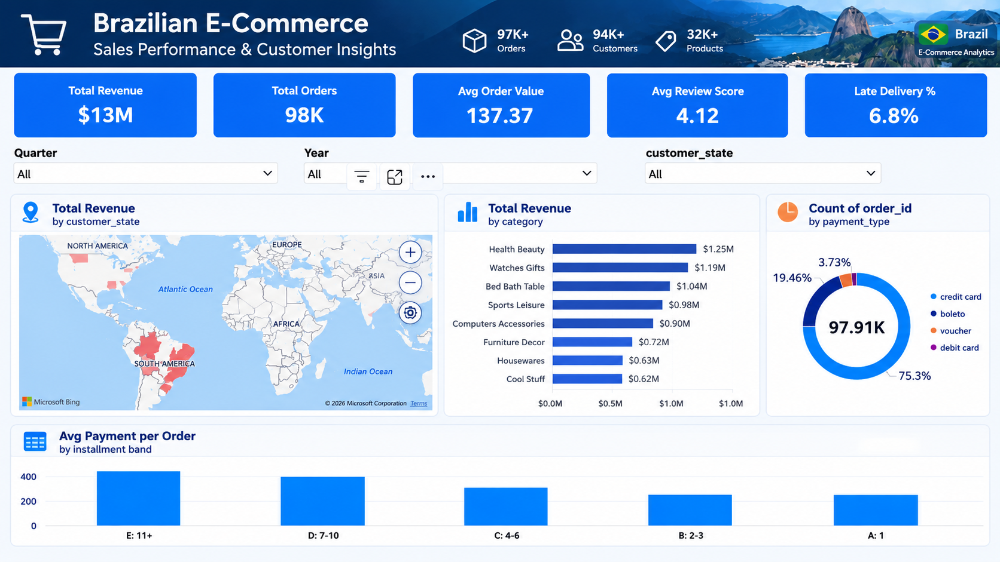
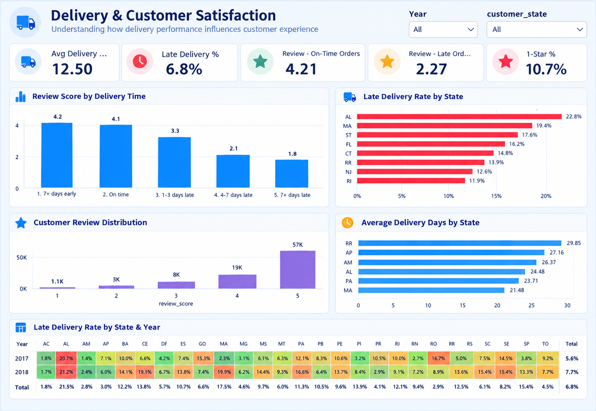
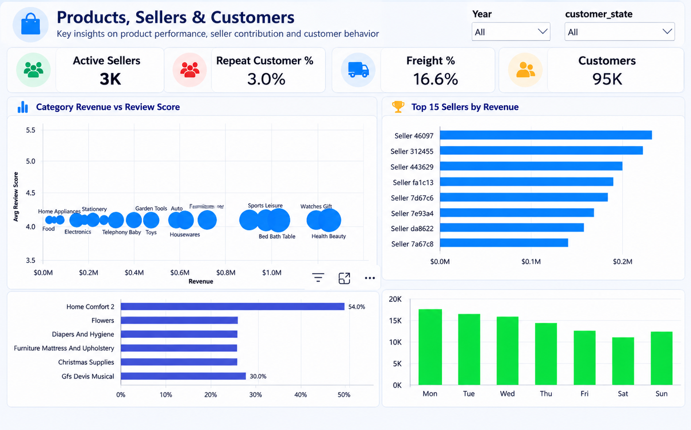

# Olist E-Commerce Analysis: Sales, Delivery and Customer Satisfaction

Analysis of about 100K Brazilian marketplace orders (Jan 2017 to Aug 2018) using Python and Power BI.

## Business questions
1. How is the business growing and where does revenue come from?
2. Is delivery performance hurting customer satisfaction?
3. How dependent is the business on a few sellers, states and customers?

## Key findings
- Revenue grew 138% in Jan-Aug 2018 vs Jan-Aug 2017, with a Black Friday spike in Nov 2017
- Late deliveries cut average review scores from 4.29 to 2.27 stars
- Late delivery rate is about 4.5% in Sao Paulo but 21.5% in Alagoas
- The top 20% of sellers generate about 82% of revenue
- Only 3% of customers placed more than one order
- Freight is 16.6% of item revenue

## Recommendations
1. Improve logistics in the north-east states (carrier agreements, regional fulfillment)
2. Test shorter delivery promises where delivery is fast (average promise is 23.6 days, actual is 12.5)
3. Run a post-delivery campaign to bring customers back
4. Reduce dependence on a few top sellers

## Tools
Python (pandas) for cleaning, Power BI for modeling and dashboards, DAX for measures

## Data cleaning (src/clean_olist.py)
| Issue | Action |
|---|---|
| Dates stored as text | Converted to date/time |
| Orders outside Jan 2017 - Aug 2018 (349) | Removed, incomplete months |
| 551 duplicate reviews | Kept the latest per order |
| 610 products without category | Labeled "Unknown" |
| 2 categories missing in translation file | Added manually |
| 2 undefined payment types | Removed |
| Geolocation 1,000,163 rows | Averaged per zip code (19,015 rows) |
| 2,965 missing delivery dates | Left blank, not invented |

## Dashboard

## How to reproduce
1. Download the Brazilian E-Commerce Public Dataset by Olist from Kaggle into 'data/raw/'
2. 'pip install pandas'
3. 'python src/clean_olist.py'
4. Load the files from 'data/cleaned/' into Power BI (see'powerbi/Olist_Analytics.pbix')

## Notes
- "Revenue" is the sum of item prices on orders that were not canceled or unavailable (it is marketplace sales value, not Olist's own income)
- Late delivery is strongly linked to low reviews, but this does not prove it causes them